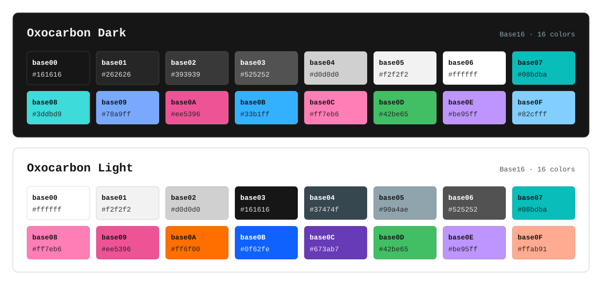

# Oxocarbon for terminals

Terminal ports of [oxocarbon.nvim](https://github.com/nyoom-engineering/oxocarbon.nvim),
a dark and light color scheme inspired by IBM Carbon.

The palette lives at the repository root so every terminal port starts from the
same values. Each terminal gets its own folder, with its own README, config
files, and installer.



## Ports

| Terminal | Directory | Ships |
| --- | --- | --- |
| [Windows Terminal](windows-terminal/) | `windows-terminal/` | 2 color schemes, 2 window themes, PowerShell installer |

New ports are welcome. Add a folder and a row to this table.

## Palettes

| File | Format | Use |
| --- | --- | --- |
| [`palettes/oxocarbon-dark.yml`](palettes/oxocarbon-dark.yml) | Base16 YAML | machine-readable dark palette |
| [`palettes/oxocarbon-light.yml`](palettes/oxocarbon-light.yml) | Base16 YAML | machine-readable light palette |
| [`palettes/palettes.txt`](palettes/palettes.txt) | plain text | both palettes, roles, ANSI mapping, port notes |

The Base16 YAML files use the standard `base00`–`base0F` slots. **Oxocarbon
does not use Base16's usual semantics**: `base08` is not red, `base0B` is not
green, and the accents deliberately favor blues. Use the explicit role names
and the ANSI mapping in `palettes/palettes.txt` instead of assuming the usual
Base16 meaning.

### Dark

| Slot | Hex | Role | Slot | Hex | Role |
| --- | --- | --- | --- | --- | --- |
| `base00` | `#161616` | background | `base08` | `#3ddbd9` | cyan |
| `base01` | `#262626` | raised background | `base09` | `#78a9ff` | blue |
| `base02` | `#393939` | selection | `base0A` | `#ee5396` | red / pink |
| `base03` | `#525252` | muted text | `base0B` | `#33b1ff` | bright blue |
| `base04` | `#d0d0d0` | foreground | `base0C` | `#ff7eb6` | pink |
| `base05` | `#f2f2f2` | bright foreground | `base0D` | `#42be65` | green |
| `base06` | `#ffffff` | white | `base0E` | `#be95ff` | purple |
| `base07` | `#08bdba` | teal | `base0F` | `#82cfff` | pale blue |

### Light

| Slot | Hex | Role | Slot | Hex | Role |
| --- | --- | --- | --- | --- | --- |
| `base00` | `#ffffff` | background | `base08` | `#ff7eb6` | pink |
| `base01` | `#f2f2f2` | raised background | `base09` | `#ee5396` | red / pink |
| `base02` | `#d0d0d0` | selection | `base0A` | `#ff6f00` | orange |
| `base03` | `#161616` | black | `base0B` | `#0f62fe` | blue |
| `base04` | `#37474f` | foreground | `base0C` | `#673ab7` | violet |
| `base05` | `#90a4ae` | muted foreground | `base0D` | `#42be65` | green |
| `base06` | `#525252` | dark gray | `base0E` | `#be95ff` | purple |
| `base07` | `#08bdba` | teal | `base0F` | `#ffab91` | peach |

The preview is generated from the YAML files:

```sh
node scripts/generate-palette-preview.mjs
```

### Light scheme caveat

The light palette is made of pastel accents intended for a mostly-white editor.
On a pure-white terminal background, the ANSI green, cyan, yellow, and red fall
below WCAG AA for normal-size text (roughly 2.3–3.3:1). This is faithful to
upstream, not a transcription error. Dark is the high-contrast option; use it
when readability matters. `white` / `brightWhite` are intentionally close to
the background in the light scheme, as in most light terminal palettes.

## Repository layout

```
README.md                       this file: generic palette + port index
palettes/                       canonical Base16 YAML + plain-text reference
assets/palette-preview.svg      generated palette preview
scripts/                        palette tooling
windows-terminal/               Windows Terminal port + installer
LICENSE
```

Terminal-specific documentation, settings, and scripts stay inside the
terminal's folder. Nothing at the root should assume Windows Terminal.

## Adding a port

1. Read `palettes/palettes.txt`. Use the explicit ANSI mapping, not Base16 slot
   semantics.
2. Create `<terminal>/` with a `README.md`, the config files, and an installer
   if the terminal supports one.
3. Link to the palette files instead of duplicating hex values where possible.
   If a format cannot import them, copy the values and note the source.
4. Add a row to the **Ports** table.
5. Keep terminal-specific paths and activation steps in the port's README.

Two colors are terminal-port extensions rather than Base16 slots:
`#ffe97b` (dark ANSI yellow) and `#dde1e6` (dark ANSI white). Use them as
extras when the terminal has more than 16 color slots.

## Credits

- [oxocarbon.nvim](https://github.com/nyoom-engineering/oxocarbon.nvim) by
  Nyoom Engineering (MIT), the reference implementation.
- [oxocarbon-alacritty](https://github.com/nyoom-engineering/oxocarbon-alacritty)
  and [oxocarbon-wezterm](https://github.com/nyoom-engineering/oxocarbon-wezterm)
  for the terminal-oriented ANSI mapping.
- Inspired by [IBM Carbon](https://carbondesignsystem.com/guidelines/color/overview/#themes).

## License

MIT. See [LICENSE](LICENSE).
